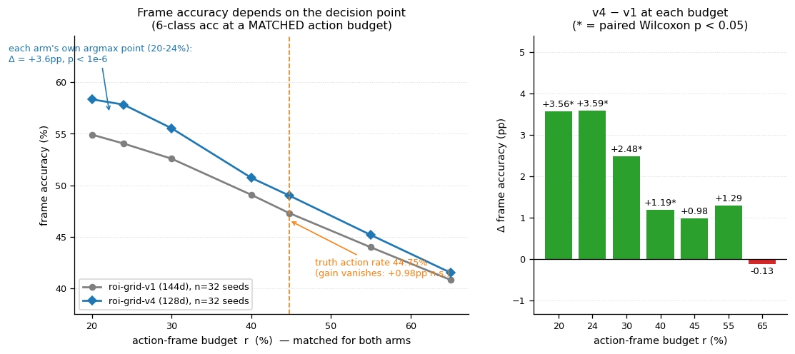
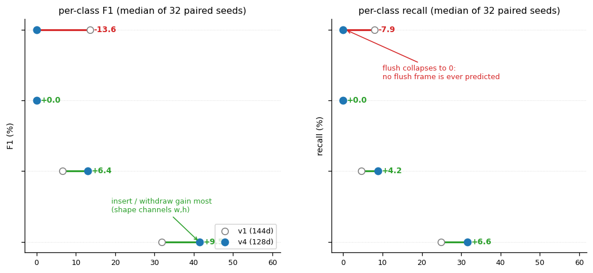

# 一页纸：本周汇报（2026-09-26 ~ 10-02）

> **5 分钟版**。技术细节见 [`WEEKLY_SYNC_20261001.md`](WEEKLY_SYNC_20261001.md)（20~30 分钟稿）；
> 结论与证据指针见 [`WEEKLY_ARCHIVE_20261001.md`](WEEKLY_ARCHIVE_20261001.md)。

## 一句话

**本周把此前提出的 11 个问题全部做成了定论**（6 项确认、4 项更正、1 项补上实测）：交付了一个可用改进
（帧准确率同口径 **+4.4pp**），并**用实测关掉三条"看起来有希望的路"**——架构、检测、离线上线；
剩下唯一能跨过 +5pp 线的路径是**目标批次数据**，需要你决策。

## 11 个问题的最终判定（本周主线）

| # | 问题 | 判定 | 一句话依据 |
|---|---|---|---|
| ① | ROI 测试数据镜像偏移 | **结论 ✅ / 机制解释 🔁 作废** | 7 行读数独立重跑逐位一致；"δ/d"被几何实测反证（随机置换 −8.3~−8.6pp > 镜像 −3.2pp） |
| ② | 数据增强 | **✅**（3 配置 / 单契约 / 单批次） | 三臂逐位复现（+0.13 / −0.73 / −2.20） |
| ③ | 数据上来说表现尚可 | **主体 ✅ / 3 处更正** | 先验·汇率·70.6% 复现；配对法、"tp/fn 不变"、弃权明细行需改 |
| ④ | 原理上解释为什么效果好 | **🔁 需重写** | "严格单变量 +3.67pp"是混淆归因 → 真值 **test +2.05 / val −0.56** |
| ⑤ | 找合适的架构 | **✅**（口径需统一） | 架构公平性网格补上后仍全败 |
| ⑥ | 检测是否可信 | **事实层 ✅ / 推理层 ⚠️** | 无框=0 成立；但对照带换 RNG 种子翻转 3 处判读 |
| ⑦ | 调整 ROI 理论基础是否成立 | **✅** | 方向成立；冷类降级"不亏"不成立 |
| ⑧ | 可能的架构试一试 | **✅** | v4 契约喂单阶段 `mstcn` 仍 −3.94pp |
| ⑨ | 评测指标是否可信 | **资产 ✅ / 强度下调** | seed↔视频级 p 差 3~4 个数量级；32 seed 只判 0.95pp |
| ⑩ | fold 特征 | **方向 ✅ / 2 处收紧** | LOO [+2.55,+5.80] 复现；"30/30 折最优"不成立 |
| ⑪ | 离线模型 | **✅ + 首次实测** | 窗口化部署 → 非 idle 预测率 18.30% → 0.00~1.17%（功能消失） |

> 逐题的完整判定与证据已**就地写入 11 份课题原文**的「补记（2026-10-02）」节
> （`TOPIC_01`…`TOPIC_10` + `TOPIC_COVERAGE_11`），不再另立文档。

## 本周三个产出

| # | 产出 | 数字（同口径） | 性质 |
|---|---|---|---|
| 1 | **特征契约 `roi-grid-v1`(144d) → `v4`(128d)** | 帧准确率 **53.90 → 58.31**，配对 **+4.47pp，32/32 全胜，p=7.9e-07** | ✅ 可用改进（带限定，见下） |
| 2 | **架构轴公平性网格**（此前最大的方法学缺口） | 27 个配置点 / **216 个 run**：给每族 1~7 个配置点 + 3 倍训练预算，**最好者仍差 3.58pp（0/16）** | ✅ 结论坐实（**省掉后续调参投入**） |
| 3 | **离线→流式实测**（此前完全空白） | 离线模型按"只看过去 W 帧"部署：**非 idle 预测率 18.30% → 0.00~1.17%**，准确率跌到平凡基线 55.25% | ⛔ 上线路径被否（**必须换因果架构重训**） |

*图注：把两臂拉到**同一动作帧预算**再比（32 对 seed）——在各自 argmax 工作点附近差 **+3.6pp**（p<1e-6），
但要求"报得和真值一样多"（44.75%）时差 **+0.98pp 且不显著**。*

## 这个 +4.4pp 的三条限定（必须一起引用）

1. **约 0.9pp 来自"更保守的决策点"**，不是表示变强：同预算下是 **+3.6pp**。
2. **是类间重分配，不是全面提升**：insert F1 **+9.46pp**、withdraw **+4.63pp**，但 **flush 召回 7.93% → 0.00%**（整类消失），
   动作类宏平均召回 **+0.01pp（p=0.93）**。若下游要 flush 事件，这条改动**净负**。
3. **统计强度被高估**：seed 级 p=7.9e-07 ↔ 视频级 p=0.008~0.070（差 3~4 个数量级）；
   单视频贡献约一半增益。
4. **绝对读数随数据版本漂移**：上游数据集 10-01 更新到 **v3.1**（标注修订：train 换 1 个视频、val 4→3；
   **test 逐字节未改**）。重训后**契约结论复现（+3.77pp，16/0）**，但**段级 `edit` 系统性下降 4~5pp**
   （v4 为 0/16 全负）→ **引用任何绝对读数必须注明数据版本**。

## 本周最重要的"负产出"：排除清单

| 被排除的方向 | 依据 | 省下的投入 |
|---|---|---|
| 换架构（5 族 / 27 配置点） | 公平性网格全部 0/8~0/16 落败 | 后续不再做架构调参 |
| 滑窗/流式部署现有离线模型 | 窗口化实测：功能塌成常数预测器 | 避免把"能离线跑"误当"能上线" |
| 数据增强（jitter / tscale） | 16 seed 配对：中性 / 有害 | 不再试这类扰动 |
| 网格镜像类增强 / TTA | 镜像掉 3.2pp，随机置换掉 8.3pp | 直接排除 |
| 检测侧改造抢分 | 动作帧无框 = 0；冷类可砍与重训读数相反 | 不再往检测端投入 |
| 标签平滑 / 权重平均 / 更多 seed 式集成 | 32 seed 实测负向或坍缩 | 直接排除 |
| **ROI 特征融合链**（`roi_classification`） | 无法验收（目标类留出集仅 21 正样本）+ 依赖 GT 框的循环依赖 + 服务的淘汰决策从未执行 | **已停用**：配置与模型别名移除、3 GB 产物回收（实现保留备查） |

## 需要你拍板的两件事

1. **验收口径**：认"全栈协议"则绝对值 59.30 已过 +5pp 线；按**严格同协议**是 58.31（距 +5pp 差 0.6pp，
   95% CI [+3.34, +5.11] 含 5）。**两种口径都自洽，但不能混用**（"59.30−53.92=+5.38"是混用协议）。
2. **是否投入目标批次数据**：哪怕 3~4 个目标批次视频参与训练/微调，也能把
   "批次差异能否在训练侧消掉"从**无解**变成**可测**。这是唯一可能跨过 +5pp 线的路径。
3. **`flush` 事件的去留**：v4 把 flush 召回打到 0.00%，v3.1 又移出了唯一的遮挡 flush 训练视频——
   若下游需要该事件，v4 不能直接上线；若不需要，则应显式声明"放弃该事件"并从验收口径里去掉。

## 下周（按性价比）

1. `flush` 专项：它是本次改动最硬的类级回归，先确认下游是否需要该事件（决定 v4 能否上线）。
2. 工作点显式化：上线前用**目标动作率**而非 argmax 定工作点，并重测段级指标。
3. 判读门限改成可执行值：**1pp 用 32 seed、0.5pp 用 ≈128 seed**（原"0.5pp 用 32 seed"功效不足）。

## ⚠️ 口径变更提示（本周 10-01 的重估，引用旧数字前必读）

| 旧说法（09-29） | 新说法（10-01） |
|---|---|
| 架构轴：五架构全败（每族一个配置点） | 已补公平性网格：**27 配置点/216 run，最好仍差 3.58pp** —— 结论不变，但**现在才真正排除了"没调参"这一解释** |
| "通道语义替换 ⇒ +3.67pp（严格单变量）" | 真·单变量是 **test +2.05pp / val −0.56pp**；+3.67pp 含网格与低频改动 |
| "增益稳定 +4.4~4.5pp"（seed 级 CI [+3.33,+5.11]） | 视频级 CI 是 **[+1.41, +8.58]**；引用时必须写统计单元 |
| "判 <0.5pp 用 ≥32 seed" | 实测 32 seed 只能判 **0.95pp**，判 0.5pp 需 **≈128 seed** |
| "流式迁移未验证" | 已实测：**功能消失**，不能靠加滑窗过桥 |
| （未提及数据版本） | 训练数据已切 **v3.1**：契约增益复现，但**段级指标下降 4~5pp** → 绝对读数必须带数据版本 |
| ROI 特征融合"先 exploratory、淘汰类确定后再登记 testset" | **已停用**（无法验收 / 循环依赖 / 服务了一个未执行的决策）→ `MODELSET_OVERVIEW.md` §9.1 |
